<a href="https://magic-show.vercel.app">
  
</a>

<h1 align="center">Magic Show — Storefront</h1>

<p align="center">Footwear and leather goods, lasted by hand in Damascus. Built to be resoled, not replaced — and so is this codebase.</p>

<p align="center">
  <a href="https://magic-show.vercel.app"></a>
  <a href="https://moumen-alkamsheh.vercel.app/work/magic-show"></a>
  <a href="https://github.com/mouminkam"></a>
</p>


| Magic Show | Repository | Stack | Live |
| --- | --- | --- | --- |
| **Storefront** · this repo | [`Magic_Show`](https://github.com/mouminkam/Magic_Show) | Next.js 16 · TypeScript | [magic-show.vercel.app](https://magic-show.vercel.app) |
| Admin console | [`Magic-Show-dashboard`](https://github.com/mouminkam/Magic-Show-dashboard) | React 19 · Vite · TanStack | [magic-show-dashboard.vercel.app](https://magic-show-dashboard.vercel.app) |
| Backend API | [`Magic-Show-back-end-`](https://github.com/mouminkam/Magic-Show-back-end-) | Laravel 12 · Sanctum | — |

## Overview

The customer-facing storefront for **Magic Show** ("Magic Shoe"), a fictional footwear and leather goods brand,
built as a full e-commerce front end with nothing skipped: strict TypeScript, a typed mock backend instead of
hard-coded arrays, hydration-safe English and Arabic, and a design system of its own.

It runs **entirely on an in-app mock data layer**: `npm install`, `npm run dev`, and the store is populated. No
database, no `.env`, no server to start first. [magic-show.vercel.app](https://magic-show.vercel.app) is this
repository, deployed as-is.

## Highlights

- **The whole storefront flow** — browse, filter, open a product, add to cart, check out, get a confirmation, leave
  and come back to the same cart, wishlist and session (persisted in `localStorage`).
- **A real blog** — article pages with hero, byline, reading time, threaded comments and related posts.
- **Store locator** on an interactive Leaflet map.
- **Full auth flow** — register, log in, forgot and reset password, including the validation and error paths.
- **English and Arabic**, right-to-left included, with a locale system that survives server rendering without a
  hydration mismatch (see Engineering notes).
- **Brand identity carried over faithfully** — accent `#f97316` on a black-and-gray scale, the real "MAGIC SHOE"
  mark at its true aspect ratio, and design tokens shaped like the admin console's, so both read as one product.

## Architecture

```text
src/
├── app/          App Router routes. Every route has the same shape: an async Server Component calls the
│                 mock service layer and hands the promise to a client "Stream" component inside <Suspense>.
├── mocks/        The mock backend: seed data plus a typed, Promise-returning service layer that simulates
│                 latency, pagination and search — swapping in the real API touches only this folder.
├── types/        Domain models: Product, Order, Cart, Customer, BlogPost…
├── store/        Zustand stores: cart, wishlist, auth, toast, theme.
├── hooks/        Shared hooks: cart helpers, theme, language.
├── lib/          Utilities, Zod schemas, formatters, phone-number normalization, i18n helpers.
├── components/   Shared UI: Header, Footer, Logo, design-system primitives.
└── locales/      i18n config and the English and Arabic dictionaries.
e2e/              Playwright specs, one per user journey.
```

**Data flow:** `app/*` (Server Component) → `mocks/*` service → promise → client `Stream` component →
Zustand stores for anything the visitor changes.

| Route | What it is |
| --- | --- |
| `/home` | Hero, featured categories, best sellers, new arrivals, blog, newsletter |
| `/shop`, `/shop/[id]` | Listing with price, size, color and season filters · product detail with variants |
| `/cart`, `/checkout`, `/order-confirmation/[id]` | Quantities and coupons · shipping and payment · confirmation |
| `/wishlist`, `/profile` | Saved items · account details, order history |
| `/blog`, `/blog/[id]` | Article list and detail |
| `/about-us`, `/contact-us`, `/stores` | Brand story · contact form and map · store locator |
| `/login`, `/register`, `/forgot-password`, `/reset-password` | Auth |

## Getting started

```bash
npm install
npm run dev        # http://localhost:3000
```

No environment variables, no seeding step: every product, order, post, review, store and account is generated
when the app boots.

## Scripts

| Command | What it does |
| --- | --- |
| `npm run dev` | Development server |
| `npm run build` · `npm start` | Production build · serve it |
| `npm run lint` | ESLint (house config) |
| `npm run typecheck` | `tsc --noEmit` |
| `npm test` | Jest unit tests (`test:watch`, `test:coverage` too) |
| `npm run test:e2e` | Playwright end-to-end tests; starts its own dev server |

CI runs lint, typecheck, unit tests and the build on every push and pull request.

## Engineering notes

### Hydration-safe internationalization

The default locale is **Arabic**, read on the server from a cookie. Reading that same cookie during a client render
is the classic hydration bug: the client already has the cookie, so its first render disagrees with the HTML the
server sent. `src/lib/getLanguageClient.ts` keeps two tools apart:

- **`useLanguageClient()`** — for anything read during render. It is built on `useSyncExternalStore`, which renders
  with the server snapshot (the default locale) while hydrating and then switches to the real cookie value, so the
  first client render always matches the server.
- **`getLanguageClient()`** — a plain function for event handlers and callbacks, where there is no server render
  to disagree with.

The test suite checks exactly that contract: hydrate with a cookie set, and the first render returns the default
while the committed value is the cookie's.

### Testing

- **Unit tests** (`npm test`) — Jest and Testing Library, concentrated on logic that is easy to get subtly wrong:
  cart totals and stock clamping, phone-number normalization, API error extraction, image fallbacks, and the
  locale hook above. 75 tests in 9 suites.
- **End-to-end tests** (`npm run test:e2e`) — Playwright, one spec per journey: home, auth, shop,
  cart/checkout/wishlist, blog, contact/about, stores, header navigation.

## Honest trade-offs

- Every route renders dynamically, with no ISR. Right for a demo on mock data; a real deployment should add
  `revalidate` to product and blog pages.
- This storefront and the admin console are two independent mock-data apps; neither calls the Laravel API yet.
  The mock service layer exists so that swap stays small and contained.
- ESLint reports **no errors and 14 warnings**: 12 from `react-hooks/set-state-in-effect` (loading flags, form
  resets on open, URL sync and mount flags that work today and can move to derived state or
  `useSyncExternalStore`), and 2 `exhaustive-deps` notes in the store locator.

<a href="https://github.com/mouminkam">
  
</a>
